# Misión Cóndor — Tecnologías y arquitectura

Juego web (navegador de escritorio y celular en horizontal) para el NASA Space Apps Challenge 2026.
Presenta: **ARQUISOFT**. Historia: `docs/GUION.md`.

## 1. Tecnologías

| Capa | Elección | Por qué |
|---|---|---|
| Motor 2D | **Phaser 3.90** (WebGL, cae a Canvas) | Escenas, tweens, cámaras, entrada táctil/teclado/mando, carga de spritesheets y escalado en una sola librería. Muy documentado: menos sorpresas en un hackathon. |
| Lenguaje | **TypeScript 5** | Tipos para el estado del jugador, los datos de la historia y las misiones. Evita errores tontos entre escenas. |
| Empaquetado | **Vite** | Arranque en ~1 s, recarga en caliente, `vite build` saca una carpeta estática (`dist/`) que se sube a cualquier hosting o se abre con un servidor local. |
| Sprites | **Motor de moldes 2.5D propio** (`herramientas/moldes/engine.js`) | El mismo de Ciudadela Cóndor: bloques 3D → pixel art isométrico, 8 direcciones × 8 cuadros + capa de brillo. Así lo nuevo combina con las 121 hojas que ya existen. |
| Audio | **Web Audio** (sintetizado en `src/core/audio.ts`) | Pitidos de texto, alarmas y motores sin archivos. Se puede sumar música en `public/audio/` cuando esté. |
| Guardado | **localStorage** | Nombre, orientación, mascota y misión alcanzada. Sin servidor ni cuentas. |
| Despliegue | Estático (GitHub Pages / Netlify / Render static) o `.zip` con `servir.mjs` | `npm run empaquetar` genera `dist/` y `MisionCondor.zip`. |

### Fluidez

- `pixelArt: true` + `roundPixels`: nada se ve borroso al escalar.
- Resolución lógica fija **960 × 540** con `Scale.FIT`: igual en monitor y en celular horizontal.
- Cada escena carga **solo sus hojas** en su `preload()`; la cinemática carga de una vez las hojas de todo su bloque (lista `sp` de cada escenario).
- Animaciones por dirección generadas una sola vez (`core/sprites.ts`), reutilizadas por todas las escenas.
- Capa de brillo con `BlendModes.ADD` en vez de shaders: barato en móviles.
- Sin físicas pesadas: los minijuegos usan movimiento simple y comprobaciones de distancia.
- Objetivo: 60 fps en un celular de gama media.

## 2. Estructura de carpetas

```
mision-condor/
├─ index.html                 Página única (contenedor del canvas)
├─ package.json · tsconfig.json · vite.config.ts
├─ public/
│  └─ sprites/
│     ├─ atlas.json           Índice de todas las hojas (lo genera herramientas/atlas.mjs)
│     └─ hojas/<categoria>/<id>.png | _brillo.png | _cielo.png | .json
├─ src/
│  ├─ main.ts                 Crea el juego Phaser y registra las escenas
│  ├─ config.ts               Tamaño, colores, orden del flujo
│  ├─ core/
│  │  ├─ estado.ts            Perfil del jugador + guardado (localStorage)
│  │  ├─ sprites.ts           Carga hojas desde atlas.json, crea animaciones por dirección, sprite con brillo
│  │  ├─ texto.ts             Reemplaza {NOMBRE}, {MASCOTA}, ingenier@ según orientación
│  │  ├─ audio.ts             Sonidos sintetizados (tecla, alarma, motor)
│  │  ├─ musica.ts            Música por momentos (tabla MOMENTOS) con fundido cruzado; archivos en public/audio/
│  │  └─ flujo.ts             Qué escena sigue a cuál (una sola fuente de verdad)
│  ├─ data/
│  │  ├─ historia.ts          Cuadros de las cinemáticas (prólogo, nudo 1-3, clímax, epílogo) con datos reales
│  │  └─ archivo.ts           Capítulos, quiénes somos y el reto (lo edita el equipo)
│  ├─ ui/
│  │  ├─ boton.ts             Kit de interfaz animado: botones (variantes, brillo, rebote), panel holográfico,
│  │  │                       cintillo de instrucción, avisos en píldora, cascada de entrada
│  │  ├─ fondo.ts             Estrellas, nebulosa, degradados
│  │  ├─ tarjeta.ts           Tarjeta «JUEGOS - MISIONES N» y tarjeta de resultado
│  │  ├─ taller.ts            Mecánicas inmersivas: piezas en pedestales del escenario, operario (el protagonista
│  │  │                       camina, toma y entrega), dron BIT-7 con rayo tractor, lista holográfica, destellos
│  │  ├─ escenarios.ts        «Modo escenario» para pantallas de interfaz: Salar, hangar, espacio, Europa
│  │  ├─ ambiente.ts          Viñeta, partículas (polvo, escarcha, chispas), estrellas fugaces, luna, hangar
│  │  └─ decorado.ts          Fondos con sprites del motor: suelo en losetas, cordillera con reflejo, nubes, utilería
│  └─ scenes/
│     ├─ Arranque.ts          Lee atlas.json y precarga lo mínimo
│     ├─ Recomendaciones.ts   12+ · auriculares · teclado
│     ├─ Logo.ts              «ARQUISOFT presenta»
│     ├─ Titulo.ts            Misión Cóndor · Jugar / Logros / Ajustes
│     ├─ Registro.ts          Nombre → Orientación → Mascota (una decisión por pantalla)
│     ├─ Cinematica.ts        Motor de cinemáticas por datos (como story.gd del juego Godot)
│     ├─ Mision1Sistemas.ts   ¿Qué necesita un vehículo para funcionar?
│     ├─ Ensamblaje.ts        Mecánica común de montaje por orden (Misiones 2 y 3)
│     ├─ Mision2Cohete.ts     Armar el cohete
│     ├─ Mision3Orion.ts      Armar la nave Orión
│     ├─ Mision4Despegue.ts   Despegue y separación de etapas
│     ├─ Mision5Rover.ts      Manejar el rover en Europa
│     ├─ Pausa.ts             Menú de pausa (⏸ / Esc / P): continuar, reiniciar misión, volver al inicio
│     ├─ Fin.ts
│     └─ Archivo.ts           Bitácora: historia por capítulos, ARQUISOFT y el reto NASA
└─ herramientas/
   ├─ moldes/                 Motor + todos los moldes + mision.js + decorados.js, el editor (hangar.html: Taller y Estudio 3D),
   │                          el catálogo (index.html) y exportar.html
   ├─ servir-moldes.mjs       Servidor local que guarda las hojas exportadas en public/sprites
   ├─ atlas.mjs               Reconstruye public/sprites/atlas.json
   ├─ servir.mjs              Servidor estático que va dentro del paquete (jugar sin internet)
   └─ empaquetar.mjs          Tras vite build: agrega servir.mjs, iniciar.bat/.sh, LEEME y crea el zip
```

## 3. Flujo de escenas

```mermaid
flowchart LR
  R[Recomendaciones] --> L[Logo ARQUISOFT] --> T[Título]
  T --> G[Registro: nombre → orientación → mascota]
  G --> C1[Cinemática PRÓLOGO]
  C1 --> C2[Cinemática NUDO 1: presupuesto]
  C2 --> M1[Misión 1 · Sistemas]
  M1 --> C3[Cinemática NUDO 2: la promesa]
  C3 --> M2[Misión 2 · Cohete] --> M3[Misión 3 · Orión] --> M4[Misión 4 · Despegue]
  M4 --> C4[Cinemática NUDO 3: Marte, Júpiter, choque en Europa, alertas]
  C4 --> M5[Misión 5 · Rover en Europa]
  M5 --> C5[Cinemática CLÍMAX: ecuación del cohete, despedida, 3-2-1]
  C5 --> C6[Cinemática EPÍLOGO] --> F[FIN]
```



El orden vive en `src/core/flujo.ts`. Cada escena termina llamando `siguiente(this)`; el estado guarda el último paso
alcanzado, así «Jugar» en el título continúa donde quedó.

## 4. Capas dentro de una escena

1. **Fondo**: gradiente + estrellas/nebulosa procedurales (`ui/fondo.ts`) o el `_cielo` de un mundo.
2. **Diorama / escenario**: hoja de `mundos/` o `escenarios/` escalada ×3–×4.
3. **Actores**: personajes, rover, mascota, naves (`core/sprites.ts → actor()`), con su brillo aditivo encima.
4. **Efectos**: humo, explosión, escudo, aurora (`efectos/`).
5. **Interfaz**: texto con máquina de escribir, botones, barras (masa, energía, combustible, O₂).

## 5. Motor de cinemáticas (v2)

`data/historia.ts` tiene los textos; `scenes/Cinematica.ts` arma cada cuadro (`ESC[escenario].armar`) con esta API:

| Llamada | Qué hace |
|---|---|
| `s.plano(de, a, ms)` | Encuadre de cámara: `{x, y, z}` = punto al centro y acercamiento. General → medio → primer plano. |
| `s.cue('palabra', fn)` | **Sincronía**: ejecuta `fn` en el instante en que la narración termina de escribir esa palabra. |
| `s.senal('palabra', objeto, 'Etiqueta', {dato})` | Señala el objeto con una etiqueta holográfica cuando se nombra. Tocarlo muestra el dato. |
| `s.rotulo(titulo, sub)` | Rótulo de lugar tipo cine. |
| `pers()` / `andar()` / `cambiar()` | Personaje con sombra, caminar hasta un punto, cambiar de pose o estado sin perder sombra, reflejo ni etiqueta. |
| `salar()` `hielo()` `marteSuelo()` `interior()` `cabina()` `espacio()` `mirador()` | Fondos con primer término en paralaje. |

Reglas: el texto se escribe letra por letra; si una palabra de `cue` no está en el texto, en desarrollo sale un aviso en consola.
Espacio / Enter / toque fuera = seguir · tocar algo señalado = ver su dato · Esc = saltar · F = pantalla completa.

**Pantalla completa**: `#juego` no usa flex (Phaser centra el lienzo y la capa DOM con márgenes; centrar dos veces lo descuadraba).

## 5b. Música (directrices «Pistas Musicales y Escenas»)

| Momento | Archivo (`public/audio/`) | Dónde suena |
|---|---|---|
| 1 · Intro de Historia | `intro.mp3` | Logo, portada, registro, Archivo y Prólogo (cuadros 1–6), sin cortes |
| 2 · Despedida del perro / buscar la cura | `despedida.mp3` | Prólogo desde Venus, Nudo 1, la promesa y Misión 5 |
| 3 · Despliegue del Cohete 123 | `despegue.mp3` | El viaje (Nudo 3) y Misión 4 |
| 3 · Rover 1 (construcción) | `construccion.mp3` | Misiones 1, 2 y 3 |
| 4 · TIC TAC ROVER | `tictac.mp3` | Descenso a Europa → rover héroe |
| 5 · Sin Combustible | `sin-combustible.mp3` | Computadora y ecuación |
| 6 · Sacrificio | `sacrificio.mp3` | Dejar masa → epílogo → FIN |

Para cambiar el reparto se edita solo `MOMENTOS` en `src/core/musica.ts`. No se usan «TRAILER» ni «Intro de Historia 2v».

## 5c. Cuerpos y colisiones

Cada molde puede declarar `foot: [x, z]` (su huella en el suelo). El exportador la guarda en la hoja y `atlas.json` (`pie`, `esc`).
`cuerposDe(actor)` (core/sprites.ts) la convierte en elipses de colisión según la escala y la dirección del actor
(los muros largos se cubren con una fila de elipses) y `empujar()` resuelve el choque: el rover resbala por el borde.
`?cuerpos` en la URL de la Misión 5 dibuja las colisiones.

## 5d. Idiomas (español / inglés)

- `core/idioma.ts`: `t('frase en español')`, `numero()`, `cambiarIdioma()`. El idioma se guarda en el perfil (`perfil.idioma`).
- `data/en.ts`: diccionario **clave = frase exacta en español → inglés**. Las frases con huecos (`'¡Encaja! ¿Cuál va ahora? Faltan {n}'`)
  también reconocen el texto ya armado con números o nombres. Si una frase falta, se ve en español (nunca se rompe).
- `instalarTraduccion()` (main.ts) engancha `Text.setText` de Phaser: **todo texto del juego se traduce solo**; no hace falta tocar cada escena.
  Guarda el original para que `retraducir(escena)` cambie en vivo la misión que queda detrás de la pausa.
- Historia: `{EL}/{SU}/{LO}` en los textos ingleses → he/she/they, his/her/their, him/her/them según la orientación.
  En las cinemáticas las señales (`s.cue('palabra')`) se buscan en el texto español y se llevan a la misma proporción del inglés.
- Interruptor **ES | EN** (`ui/selectorIdioma.ts`) arriba en Recomendaciones, Portada y Pausa. `?idioma=en` en la URL fuerza inglés para probar.
- Para agregar un texto nuevo: escribirlo en español en la escena y sumar su línea a `data/en.ts`.

## 6. Sprites

- Hojas existentes reutilizadas: 116 (ciudadela, flota, herramientas, mundos, planetas, efectos…).
- Nuevas: 24 (`herramientas/moldes/mision.js`), ver `docs/SPRITES.md`.
- Regenerar: `npm run moldes` → abre `http://localhost:8791/exportar.html#auto` → guarda en `public/sprites/hojas/mision/` y actualiza `atlas.json`.

## 7. Empaquetado

```
npm install
npm run dev          # desarrollo en http://localhost:5173
npm run empaquetar   # dist/ + MisionCondor.zip (incluye servir.mjs para abrir sin internet)
```
