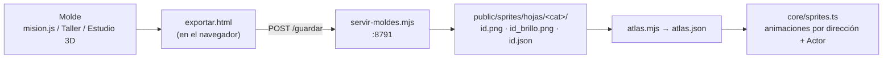
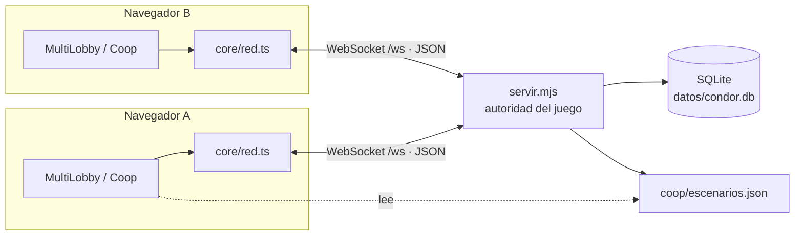
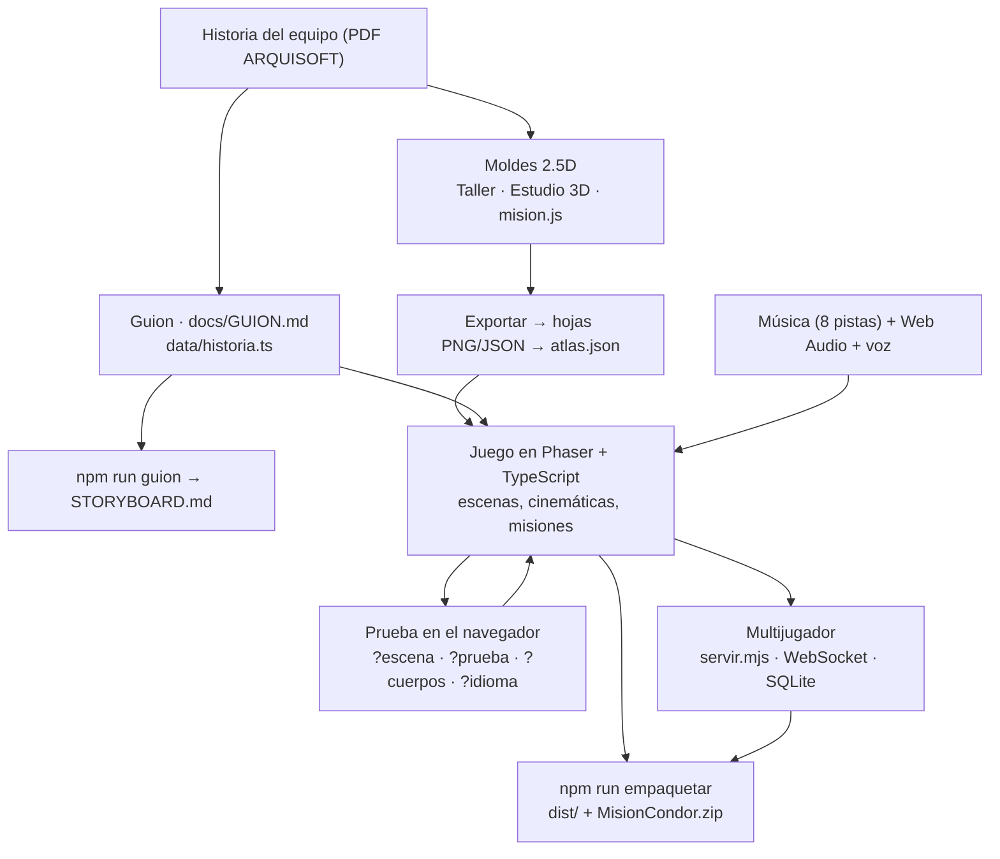

# Misión Cóndor — Stack tecnológico y proceso de desarrollo

**ARQUISOFT · NASA Space Apps Challenge 2026**

Este documento cuenta con qué herramientas y en qué orden se hizo el juego: los sprites, el motor, el desarrollo y el
multijugador. Para el detalle de cada escena, ver [ARQUITECTURA.md](ARQUITECTURA.md). Para la lista de sprites, ver
[SPRITES.md](SPRITES.md).

---

## 1. Resumen en una tabla

| Área | Tecnología | Versión | Para qué |
|---|---|---|---|
| Lenguaje del juego | **TypeScript** | 5.9 | Tipos para el perfil del jugador, la historia y las misiones |
| Motor de juego 2D | **Phaser** | 3.90 (WebGL, cae a Canvas) | Escenas, cámaras, tweens, entrada táctil, teclado y mando, carga de hojas |
| Empaquetador y servidor de desarrollo | **Vite** | 7 | Recarga en caliente, `vite build` → carpeta estática `dist/` |
| Motor de sprites | **Motor de moldes 2.5D propio** (`herramientas/moldes/engine.js`) | — | Convierte bloques 3D en pixel art isométrico de 8 direcciones × 8 cuadros |
| Editor de sprites | **Hangar: Taller + Estudio 3D** (`hangar.html`) | — | Editor visual propio, sin programas externos |
| Herramientas de línea de comandos | **Node.js** (scripts `.mjs`, sin dependencias) | 22.5+ (probado con 24.15) | Exportar sprites, armar el atlas, el guion gráfico y el paquete |
| Multijugador | **WebSocket propio (RFC 6455) sobre `node:http`** | — | Salas de 2 jugadores con código, el servidor tiene la autoridad |
| Base de datos | **SQLite** (`node:sqlite`, viene con Node) | — | Jugadores, salas, partidas y ranking |
| Audio | **Web Audio API** + 8 pistas `.mp3` | — | Efectos sintetizados sin archivos y música por momentos con fundido cruzado |
| Voz | **Web Speech API** (`speechSynthesis`) | — | Narración opcional en el idioma del juego |
| Tipografías | **@fontsource/press-start-2p** y **@fontsource/open-sans** | 5.3 | Fuentes locales, funcionan sin internet |
| Guardado | **localStorage** | — | Perfil, idioma, dificultad, misión alcanzada e identidad del modo cooperativo |
| Despliegue | Hosting estático o `.zip` con servidor Node | — | GitHub Pages, Netlify o Render. Fuera de línea con `iniciar.bat` |
| Asistente de desarrollo | **Claude Code** (app de escritorio) | — | Programación, pruebas en el navegador integrado y documentación |

**Principio del stack:** la menor cantidad posible de dependencias. El juego solo instala Phaser y dos fuentes. El
servidor, el exportador y el empaquetador usan solo módulos que vienen con Node. En un hackathon eso significa menos
cosas que se rompan y un `.zip` que funciona en cualquier PC.

---

## 2. De dónde viene: tres proyectos, una línea

```mermaid
flowchart LR
  A["Lo que el Monte Guarda<br/>Godot 4.3 · GDScript<br/>(oct 2026)"] --> B["Ciudadela Cóndor<br/>nassachallenge/<br/>Canvas 2D · motor de moldes"]
  B --> C["Misión Cóndor<br/>mision-condor/<br/>Vite + TypeScript + Phaser"]
  B -. reutiliza 116 hojas y el motor de moldes .-> C
  A -. idea del motor de cinemáticas por datos (story.gd) .-> C
```

| Proyecto | Motor | Qué se llevó al siguiente |
|---|---|---|
| **Lo que el Monte Guarda** (raíz `F:\gamericr`) | Godot 4.3, GDScript, pruebas automáticas de niveles (`tools/tests/`) | Cinemáticas armadas a partir de datos (`story.gd`) y la costumbre de probar todo antes de entregar |
| **Ciudadela Cóndor** (`nassachallenge/`) | Canvas 2D a mano, y-sort | El **motor de moldes 2.5D**, el editor Hangar y 116 hojas de sprites |
| **Misión Cóndor** (`mision-condor/`) | Phaser 3.90 + TypeScript | Juego final: historia del PDF del equipo, 5 misiones y cinemáticas |

Se pasó de Canvas a mano a **Phaser** para no tener que reescribir lo que un motor ya trae: escalado a la pantalla,
cámaras con acercamiento, tweens, escenas en paralelo (como la pausa) y entrada táctil.

---

## 3. Proceso de sprites (del molde al juego)

### 3.1 Cómo funciona el motor de moldes

`herramientas/moldes/engine.js` es un **rasterizador de vóxeles** escrito en JavaScript:

1. Un **molde** describe un objeto con bloques 3D (`B(x, y, z, ancho, alto, fondo, color)`) y piezas compuestas
   (`oct` para cilindros, `dome` para cúpulas, cápsulas, cuñas, anillos…).
2. El motor dibuja cada cara con **z-buffer y sin antialiasing**, con **luz cuantizada** en 5 tonos (6 para planetas),
   un **contorno** y una **paleta común** (traje, metal, cian, oro, fuego…), así todo combina.
3. Gira el molde en **8 direcciones** (de 45° en 45°) y anima **8 cuadros** por dirección.
4. Saca dos capas: el color y un **`_brillo.png`** (luces, visores, propulsores) que el juego dibuja en modo aditivo.
   Los mundos además sacan un **`_cielo.png`**.
5. Cada molde puede declarar su **huella en el suelo** (`foot: [x, z]`). De ahí salen las colisiones del juego.

### 3.2 Herramientas

| Herramienta | Dirección | Qué hace |
|---|---|---|
| **Taller** (`hangar.html`) | `http://localhost:8791/` | Arma sprites por piezas con vista previa animada |
| **Estudio 3D** (pestaña del Hangar, `estudio.js`) | igual | Editor tipo modelador: 4 vistas, árbol de piezas, mover, rotar y escalar (G / R / S + eje), espacio JSON y espacio Render |
| **Catálogo** (`index.html`) | `http://localhost:8791/index.html` | Muestra todos los moldes en sus 8 direcciones |
| **Exportador** (`exportar.html`) | `http://localhost:8791/exportar.html#auto` | Genera las hojas PNG + JSON y revisa errores |
| `servir-moldes.mjs` | puerto 8791, solo esta PC | Recibe lo que exporta el navegador y lo guarda en `public/sprites/hojas/` |
| `atlas.mjs` | `npm run atlas` | Lee todas las hojas y arma `public/sprites/atlas.json` |

Los moldes se escriben en archivos por tema: `mision.js` (los nuevos de Misión Cóndor), `decorados.js`, `personajes.js`,
`flota.js`, `ciudadela.js`, `mundos.js`, `planetas.js`, `efectos.js`… Hay 23 archivos de moldes en total. Lo que se crea en
el Taller se guarda en `creaciones.js`.

### 3.3 Flujo



```
npm run moldes        # abre el editor y exportador en :8791
# → exportar.html#auto  (o exportar.html?solo=decorados#auto para una sola categoría)
```

### 3.4 Formato de hoja

- Cuadrícula **8 × 8**: columnas = dirección (0 = de frente, **2 = mira a la izquierda**, **6 = mira a la derecha**),
  filas = cuadros de animación.
- JSON **estilo Aseprite** con un bloque `meta.condor`: `fps`, `bucle`, `pivote`, `brillo`, `cielo`, `pie`, `escalaMolde`.
- `atlas.json` resume todo: tamaño de celda, ancla, capas y cuerpo de cada sprite.
- El exportador **revisa** recortes, saltos en el bucle de animación, azar sin semilla y lentitud
  (`revision-mision.txt`).

### 3.5 Inventario actual: 205 hojas en 15 categorías

| Categoría | Hojas | | Categoría | Hojas |
|---|---|---|---|---|
| mision | 58 | | efectos | 10 |
| decorados | 20 | | escenarios | 8 |
| flota | 19 | | estados | 8 |
| objetos | 16 | | movimientos | 8 |
| ciudadela | 14 | | mundos | 8 |
| herramientas | 12 | | planetas | 8 |
| intro | 6 | | personajes | 6 |
| creaciones | 4 | | | |

---

## 4. Motor del juego y desarrollo

### 4.1 Configuración de Phaser

- Resolución lógica fija **960 × 540** con `Scale.FIT`: se ve igual en un monitor y en un celular horizontal.
- `pixelArt: true` + `roundPixels`: el pixel art no se ve borroso al escalarlo.
- Capa DOM activada (`dom.createContainer`) para los campos de texto (nombre, correo, código de sala).
- Capa de brillo con `BlendModes.ADD` en vez de shaders, para que sea liviano en celulares.
- Sin motor de físicas: las colisiones son **elipses** que salen de la huella del molde (`cuerposDe` + `empujar`).
- Cada escena carga **solo sus hojas** en `preload()`. Meta: 60 fps en un celular de gama media.

### 4.2 Módulos propios (`src/`)

| Carpeta | Módulos | Qué resuelven |
|---|---|---|
| `core/` | `estado` · `flujo` · `sprites` · `texto` · `idioma` · `audio` · `musica` · `voz` · `dificultad` · `red` | Guardado, orden de escenas, actores con brillo y cuerpo, `{NOMBRE}`/`{MASCOTA}`, ES/EN, sonido, música, narración, modo Cadete/Ingeniería, conexión multijugador |
| `data/` | `historia` · `archivo` · `intro` · `en` | Textos de cinemáticas, bitácora del equipo y diccionario inglés |
| `ui/` | `boton` · `panel` · `taller` · `escenarios` · `decorado` · `ambiente` · `cine` · `fondo` · `presupuesto`… | Kit de interfaz holográfica, fondos armados con sprites, partículas y efectos de cine |
| `scenes/` | 20 archivos | Arranque → Recomendaciones → Logo → Intro de radio → Título → Registro → Cinemáticas + 5 misiones + Ecuación → Fin, más Pausa, Archivo, MultiLobby y Coop |

### 4.3 Sistemas destacados

- **Motor de cinemáticas por datos:** `data/historia.ts` guarda los textos y `Cinematica.ts` arma cada cuadro con
  `plano()` (cámara), `cue('palabra')` (pasa algo justo cuando la narración escribe esa palabra), `senal()` (etiqueta
  holográfica que se puede tocar) y `rotulo()`.
- **Traducción automática ES/EN:** `instalarTraduccion()` intercepta `Text.setText` de Phaser, así **todo texto se
  traduce** con el diccionario `data/en.ts` sin tocar cada escena. Ajusta los pronombres según la orientación elegida.
- **Música por momentos:** la tabla `MOMENTOS` de `core/musica.ts` decide qué pista suena en cada escena o cuadro.
  Hay 8 pistas `.mp3` en `public/audio/`, con fundido cruzado.
- **Efectos sintetizados:** teclas, alarmas y motores se generan con Web Audio, sin archivos.

### 4.4 Herramientas del día a día

| Comando | Qué hace |
|---|---|
| `npm run dev` | Servidor de desarrollo en `http://localhost:5173` (también en la red local con `--host`) |
| `npm run build` | `tsc --noEmit` (revisa tipos) + `vite build`. Phaser va en su propio archivo (`manualChunks`) |
| `npm run moldes` | Editor, catálogo y exportador de sprites en `:8791` |
| `npm run atlas` | Rehace `atlas.json` |
| `npm run guion` | Genera `docs/STORYBOARD.md` leyendo el código (texto, transición, cámara y música de cada cuadro) para que el guion gráfico nunca quede desactualizado |
| `npm run servidor` | Servidor multijugador en `:8787` (Vite le reenvía `/ws` y `/api`) |
| `npm run empaquetar` | Atlas + build + `servir.mjs`, `iniciar.bat` / `iniciar.sh`, `LEEME.txt` y `MisionCondor.zip` |

**Atajos de prueba por URL:** `?escena=Mision4Despegue` · `?escena=Cinematica&bloque=nudo3` · `?prueba` (bucle con
temporizador para pestañas en segundo plano) · `?cuerpos` (dibuja las colisiones) · `?idioma=en`.

**Forma de trabajo:** cada cambio se prueba en el navegador antes de darlo por terminado. En este proyecto se usó el
navegador integrado de Claude Code, con capturas, consola y saltos directos a la escena con los atajos de arriba.

---

## 5. Multijugador cooperativo

> **Estado:** en construcción. El servidor (`herramientas/servir.mjs`), el cliente (`src/core/red.ts`) y las escenas
> `MultiLobby.ts` y `Coop.ts` ya existen, pero las dos escenas **todavía no están registradas** en la lista de
> `src/main.ts`.

### 5.1 La idea

Dos jugadores se ven caminando por la Ciudadela del Salar (al estilo de *Among Us*):

- **Recolector:** recorre el mapa, toma piezas (el carro aguanta 2 espacios y las piezas de 150 kg o más ocupan los
  dos) y las entrega en el hangar.
- **Ingeniero:** en la mesa del hangar decide qué pieza va en cada lugar, la calibra y pide lo que falta, sin pasar
  del límite de masa (900 kg en el escenario `salar`).

### 5.2 Arquitectura



| Pieza | Detalle |
|---|---|
| Transporte | **WebSocket escrito a mano** (handshake SHA-1, tramas de texto, máximo 64 KB por mensaje) sobre `node:http`. No usa `ws` ni `socket.io` |
| Autoridad | **El servidor decide** quién toma qué pieza, si un montaje vale y cuándo se gana. El cliente solo dibuja y manda *intenciones* |
| Salas | Código de letras sin caracteres que se confunden (sin I, O, 0, 1). Roles que se intercambian solos si los dos eligen el mismo. Botón «Estoy listo» |
| Mensajes | `hola` · `crear` · `unirse` · `rol` · `escenario` · `listo` · `pos` · `tomar` · `entregar` · `montar` · `descartar` · `pedir` · `emote` · `salir` |
| Posiciones | `pos` se reenvía al compañero con dirección y si se está moviendo. Las posiciones viejas **no se encolan** |
| Reconexión | El cliente reintenta con espera creciente (0,5 s → 8 s como máximo), vuelve a identificarse y a unirse a su sala. El servidor le **guarda el lugar 2 minutos** |
| Escenarios | `public/coop/escenarios.json`: mapa, decorados con cuerpo sólido, punto de inicio de cada rol, mesa, entrega y tiempo. Lo leen el cliente **y** el servidor |
| Identidad | Correo + nombre, guardados en `localStorage` (`mision-condor:coop`). No hay contraseñas |

### 5.3 Base de datos (SQLite)

```sql
jugadores (email PK, nombre, creado, visto)
salas     (codigo PK, escenario, anfitrion, creada, estado)
partidas  (id PK, sala, escenario, ingeniero, recolector, segundos, errores, estrellas, fecha)
```

API HTTP: `GET /api/salud` (estado y salas abiertas) · `GET /api/ranking?escenario=salar` (los 10 mejores por estrellas
y tiempo).

### 5.4 Puertos

| Puerto | Qué corre |
|---|---|
| 5173 | Vite (juego en desarrollo). Reenvía `/ws` y `/api` → 8787 |
| 8787 | `servir.mjs` solo multijugador (desarrollo) |
| 8791 | Editor y exportador de sprites |
| 8080 | `servir.mjs` dentro del paquete: juego + multijugador + base de datos en un solo proceso |

---

## 6. Entrega y despliegue

```
npm install
npm run empaquetar     # → dist/ + MisionCondor.zip
```

- **Sin internet:** se descomprime el `.zip` y se hace doble clic en `iniciar.bat` (o `sh iniciar.sh`). Se abre
  `http://localhost:8080/`. Los celulares en la misma Wi-Fi entran con la IP de la PC.
- **En internet (solo un jugador):** se sube `dist/` a cualquier hosting estático (GitHub Pages, Netlify o Render Static
  Site). `base: './'` hace que funcione en cualquier subcarpeta.
- **En internet (multijugador):** necesita un servicio Node que corra `servir.mjs` (por ejemplo, un Web Service de
  Render). La carpeta `datos/` debe guardarse en un disco que no se borre.

---

## 7. Proceso completo en un diagrama


